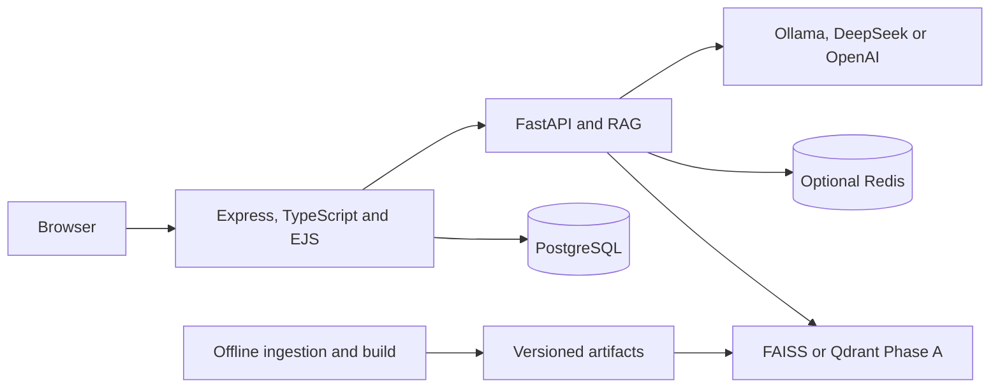

# ITLR–RAG

ITLR–RAG is a Vietnamese-first IT learning platform. Learners search curated resources,
ask questions with source citations, and track progress on learning paths.

**LOCAL READY · STAGING HOLD · PRODUCTION NO-GO**

[Tiếng Việt](README.vi.md) · [Maintainer guides](docs/README.md) · [Release evidence](reports/REPOSITORY_CLEANUP.md)

## Architecture



Express owns authentication, conversations, user progress, confirmed agent writes,
and handoff. FastAPI combines E5 dense retrieval with BM25 and reciprocal rank fusion.
It binds answers to selected source excerpts and can abstain. FAISS serves by default.
Qdrant Phase A is opt-in, and native hybrid runs only in evaluation.
[Architecture](docs/ARCHITECTURE.md) · [API and tools](docs/API.md) · [RAG](docs/RAG.md)

## Docker Compose (full stack)

Use Docker Compose v2. Prepare a verified artifact version and Web catalog for a new
checkout. The deployment runbook covers snapshot import, model cache and artifact setup.
[Data preparation](deploy/DEPLOY.md#nạp-dữ-liệu)

From the repo root, create a private configuration file and replace its placeholders.

```bash
(umask 077; set -C; cat .env.docker.example > .env.docker)
docker compose --env-file .env.docker -f compose.local.yml config --quiet
```

Follow the [local Compose runbook](deploy/DEPLOY.md#docker-compose-local) to build,
migrate and sync the intended local database, and start the stack. Open
[Web](http://localhost:3000). Check FastAPI at `/health` on port 8000 and Web at
`/ready` on port 3000.

## Native development and tests

Use Python 3.11+, Node.js 22 and PostgreSQL 16.
[Native setup](deploy/DEPLOY.md#cài-đặt) · [Development guide](docs/development/README.md)

```bash
python3 -m venv .venv
.venv/bin/python -m pip install -r requirements.txt
(cd web && npm ci)
```

Run the [Python and Web checks](docs/TESTING.md) before submitting changes.
`itlr/` contains Python services, `web/` the application and schema,
`scripts/` operational commands, and `eval/` frozen evaluations. Runtime data lives
under `var/`. Versioned inputs and source attribution live in [data/](data/README.md).

## Configuration and deployment

Use [API](.env.example) and [Web](web/.env.example) templates for native development
or the [Docker template](.env.docker.example) for Compose. Use `LLM_PROVIDER=none`
for template-only generation on the native API or agent overlay. Cloud staging
requires authorization, shared quotas and separate provider credentials.
[Deployment profiles](docs/deployment/README.md) · [Provider setup](deploy/DEPLOY.md#credential-của-llm-staging)

Use private listeners and role-specific credentials. Check readiness and the loaded
artifact fingerprint after activation or rollback. Rehearse a restore on an isolated
target. [Operations](docs/operations/README.md) · [Security boundaries](docs/SECURITY.md)

## Release limits

The application serves one organization per deployment. Multi-tenant isolation is
unverified. CPU generation exceeds the 45-second p95 gate, and independent human
faithfulness review is pending. Same-host recovery has scoped evidence. Multi-host
recovery and sustained generation capacity remain open. [Current gates](reports/REPOSITORY_CLEANUP.md)

[Contributing](CONTRIBUTING.md) · [Report a vulnerability](SECURITY.md) · [Source rights and attribution](data/README.md)

Repository-wide open-source licensing is unverified. Third-party materials retain their
source-specific terms.
