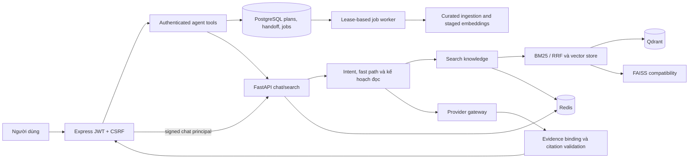

# Kiến trúc nền tảng agent

FastAPI giữ API search, chat và SSE hiện có. Với chunk artifacts, chatbot phân loại intent, dùng fast path nếu có, rồi lập kế hoạch tối đa hai lần gọi công cụ tri thức theo type filter. Pydantic kiểm input, output và chunk owner. API gắn `X-Request-ID`; OTel và debug log theo dõi tên tool, elapsed và outcome. Excerpt từ retrieval chỉ đi vào evidence. Lệnh do model hay nguồn đề xuất không được dispatch.

Express cung cấp công cụ riêng theo phiên đã xác thực. PostgreSQL giữ progress và snapshot kế hoạch đã duyệt. Idempotency và audit của ghi kế hoạch và handoff cùng nằm trong transaction. Redis chứa dữ liệu ngắn hạn của public corpus và bộ đếm. LLM chọn bằng chứng và dựng câu trả lời qua các chế độ cũ. Ứng dụng giữ nguyên citation/stream validation, gồm cancel và final + done + EOF tại Web.

Phạm vi single-host, lộ trình triển khai và cổng bằng chứng ở [scalability](SCALABILITY_PLAN.md) và [release readiness](../../reports/RELEASE_READINESS.md).
