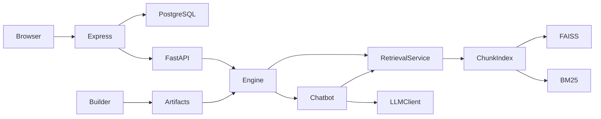
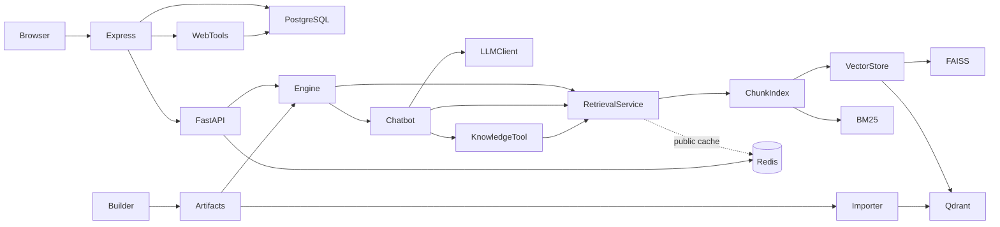

# Đồ thị phụ thuộc migration agent

Graphify AST trên 233 file Python, TypeScript và JavaScript do Git theo dõi trước migration trả 2.484 nodes và 6.619 edges. AST ghi nhận symbol/call/import. Các cạnh HTTP, DB và Docker bên dưới được đối chiếu thủ công với cấu hình.

## Trước

Sau migration, cùng cách trích xuất trên 252 file source và test trả 2.637 nodes và
7.193 edges. Phạm vi loại trừ Markdown, dữ liệu runtime và file dependency vendored.

## Sau

## Agent hardening

Graphify trên 262 file code và test trả 2.715 nodes và 7.460 edges. Luồng mới nối Web
principal đã ký đến FastAPI admission, Handoff đến PostgreSQL, và worker vào job queue.
[Sơ đồ hiện tại](AI_AGENT_ARCHITECTURE.md) · [Audit và bằng chứng](../../reports/AGENT_HARDENING_2026-11-18.md).
