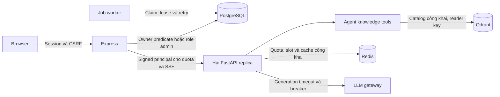

# ITLR–RAG · Staging readiness

**2026-11-18 · HOLD.** LOCAL READY trong phạm vi đã kiểm. STAGING READY chưa đạt.
Production vẫn NO-GO. Phạm vi chạy là hai tiến trình FastAPI trên một host, một Express
và PostgreSQL, Redis, Qdrant và Ollama cách ly, dùng artifact catalog 118 mục và 1.576
chunks. Mốc so sánh là [Agent hardening](AGENT_HARDENING_2026-11-18.md).

## Cổng nghiệm thu

| Ưu tiên | Gate | Kết quả | Bằng chứng |
|---|---|---|---|
| P0 | Cross-user, IDOR, role và ghi đồng thời | **PASS trong phạm vi đã kiểm.** Hai tài khoản thật trong PostgreSQL fixture. Peer nhận 404 khi gửi chat vào hội thoại của owner. User thường nhận 403 khi đọc hàng đợi handoff. Hai ghi đồng thời thành công và giữ đủ sáu message. | [Replica probe](final-e2e-evidence/staging-sprint-2026-11-18/replicas.log), [ownership RED](final-e2e-evidence/staging-sprint-2026-11-18/ownership-red.log) |
| P0 | Cross-tenant | **BLOCKED.** Express và FastAPI từ chối tenant selector đã định danh ở biên. Schema chưa có tenant membership hoặc hai phạm vi dữ liệu riêng để nghiệm thu. | [ADR-015](../docs/decisions/ADR-015-staging-boundaries.md), [scope RED](final-e2e-evidence/staging-sprint-2026-11-18/scope-red.log) |
| P0 | Faithfulness độc lập | **BLOCKED.** 20 ca có câu trả lời và bằng chứng đã lưu, 0 reviewer, faithfulness `null`. | [Phiếu chấm](final-e2e-evidence/staging-sprint-2026-11-18/review-sheet.csv), [protocol](release-readiness-evidence/HUMAN_REVIEW_PROTOCOL.md) |
| P0 | Agent p95 ≤45 giây | **FAIL.** Qwen2.5:3b CPU-only đạt 91,50 giây ở concurrency 4, với 3/4 câu đạt tiêu chí đầu ra. | [Ollama E2E](final-e2e-evidence/staging-sprint-2026-11-18/ollama.json) |
| P0 | Cloud usage, cache hit và billing | **BLOCKED.** Guard cấu hình staging có regression test. Chưa được cấp quyền chạy paid API hoặc giới hạn ngân sách. Cloud latency, token usage, cache hit, chi phí thực và savings đều `null`. | [Cloud guard RED](final-e2e-evidence/staging-sprint-2026-11-18/cloud-red.log), [secret handling GREEN](final-e2e-evidence/staging-sprint-2026-11-18/secret-redaction-green.log), [cấu hình](../deploy/DEPLOY.md) |
| P0 | Multi-replica và failure recovery | **PASS single-host trong phạm vi đã kiểm.** Quota chung, cache chia sẻ, invalidation theo epoch, SSE release, Redis và Qdrant outage/recovery. PostgreSQL job leases và restore kiểm riêng trên cùng host. | [Replica](final-e2e-evidence/staging-sprint-2026-11-18/replicas.log), [epoch](final-e2e-evidence/staging-sprint-2026-11-18/epoch-restart.log), [outage](final-e2e-evidence/staging-sprint-2026-11-18/failure.log), [jobs](final-e2e-evidence/staging-sprint-2026-11-18/jobs.log) |
| P0 | Retrieval giữ chất lượng | **PASS holdout cho cấu hình so sánh.** Recall@5 bằng Phase A, negative/OOD 8/8 rỗng. Quyền promote native vẫn **HOLD** đến khi có human evidence. FAISS mặc định, Qdrant Phase A opt-in. | [Holdout](final-e2e-evidence/staging-sprint-2026-11-18/holdout.json), [frozen cases](production-blockers-evidence/frozen-blind-cases.jsonl) |
| P0 | Full regression | **PASS.** 559 → 564 Python, 176 → 177 Web, typecheck/lint/build và compileall PASS. Python statement coverage 68%. Web line coverage 55,43% → 55,29% (−0,14 điểm %). | [Python](final-e2e-evidence/staging-sprint-2026-11-18/python-final.log), [Python coverage](final-e2e-evidence/staging-sprint-2026-11-18/python-coverage.log), [Web](final-e2e-evidence/staging-sprint-2026-11-18/web-final.log) |
| P0 | Rollback và audit trail | **PASS trong phạm vi fixture.** Qdrant alias rollback và snapshot restore, PostgreSQL dump/restore trên DB mới, agent action audit/idempotency được bao phủ bởi regression. | [Qdrant](final-e2e-evidence/staging-sprint-2026-11-18/lifecycle.log), [PostgreSQL](final-e2e-evidence/staging-sprint-2026-11-18/backup.log), [scope](../docs/architecture/SECURITY_REVIEW.md) |
| P1 | Advisory picomatch | **OPEN.** npm registry trả 12 High ở dev tree qua cùng advisory. Runtime audit 0. GitHub advisory ghi withdrawn, và phiên bản 4.0.7 là bản mới nhất đã kiểm. Không có upgrade đã xác nhận giải quyết cảnh báo registry. Dry-run lockfile hết thời gian. | [npm dev](final-e2e-evidence/staging-sprint-2026-11-18/npm-audit.json), [npm runtime](final-e2e-evidence/staging-sprint-2026-11-18/npm-runtime.json), [dependency tree](final-e2e-evidence/staging-sprint-2026-11-18/picomatch-tree.log), [dry-run](final-e2e-evidence/staging-sprint-2026-11-18/npm-safe-dry-run.log), [advisory](https://github.com/advisories/GHSA-fc5q-39xc-vjpf), [releases](https://github.com/micromatch/picomatch/releases) |
| P2 | Capacity và HA | **OPEN.** Có số liệu 120 giây trên cache hit. Chưa đủ để xác nhận tải sustained của generation, fault domain đa host hay PostgreSQL failover. | [Soak](final-e2e-evidence/staging-sprint-2026-11-18/soak.json) |

## Tenant authorization

Express dùng session và PostgreSQL user cho công cụ riêng tư. Kiểm ownership và đọc lịch sử
chat dùng chung một snapshot SQL. Các route ghi chat giữ lock trong transaction, cùng kiểm
owner. Handoff đòi role admin. Web ký principal gửi FastAPI cho quota theo user. Agent
knowledge truy vấn catalog công khai qua Qdrant đã pin collection, Redis lưu cache công khai
theo artifact/epoch. [ADR-015](../docs/decisions/ADR-015-staging-boundaries.md).

## Retrieval holdout và human review

Holdout frozen có 20 ca Anh/Việt. Mỗi ngôn ngữ có 6 câu dương và 4 câu âm/OOD. Không có
câu nào trùng nguyên văn với ba tập đã dùng để phát triển gate. Nhãn theo protocol blind
trước đó do AI chuẩn bị. Dense floor giữ 0,84 và K=5. Native gated và Phase A đều có
Recall@5, MRR@5 và nDCG@5 **83,33%**, negative/OOD rỗng **8/8**. Core p95 lần lượt
**39,77 ms** và **23,18 ms**. SHA của holdout và manifest nằm trong JSON.
[Evaluator](../eval/eval_staging_holdout.py), [bằng chứng từng ca](final-e2e-evidence/staging-sprint-2026-11-18/holdout.json).

Annotation packet dùng 20 câu trả lời thật được lưu từ lần certification 2026-10-31. ID ca
được xáo và cột đánh giá để trống. Reviewer độc lập cần chấm claim dựa trên passage, ghi
mâu thuẫn hoặc thiếu bằng chứng rồi đối soát theo protocol. Bộ phiếu này đo các câu trả lời
lịch sử. Cần chạy và chấm thêm mẫu staging với provider được chọn để xác nhận run hiện tại.
[Packet](final-e2e-evidence/staging-sprint-2026-11-18/annotation-packet.jsonl),
[manifest](final-e2e-evidence/staging-sprint-2026-11-18/annotation-manifest.json),
[protocol](release-readiness-evidence/HUMAN_REVIEW_PROTOCOL.md).

## Generation và tải

Workload dùng Express session với CSRF và Web SSE, qua FastAPI, Qdrant Phase A và Ollama
Qwen2.5:3b CPU-only. Bốn truy vấn cố định Anh/Việt về Docker và Python logging, phát theo
batch 1, 2, 4. Container Ollama giới hạn 4 CPU. TTFT là lúc nhận SSE text đầu tiên. Total gồm toàn bộ request đến khi đóng
stream. Tiêu chí accepted đòi final dạng `llm_extractive`, citation valid và SSE done.
[Workload](../eval/bench_agent_gateway.py), [host](final-e2e-evidence/staging-sprint-2026-11-18/test-host.txt), [số liệu thô](final-e2e-evidence/staging-sprint-2026-11-18/ollama.json).

| Concurrency | Accepted | TTFT p50 / p95 / p99 (s) | Total p50 / p95 / p99 (s) |
|---:|---:|---:|---:|
| 1 | 1/1 | 48,46 / 48,46 / 48,46 | 48,50 / 48,50 / 48,50 |
| 2 | 2/2 | 36,71 / 37,49 / 37,56 | 36,74 / 37,50 / 37,57 |
| 4 | 3/4 | 89,85 / 91,58 / 91,73 | 68,09 / 91,50 / 91,73 |

Ở concurrency 4 một câu trả `insufficient_evidence` sau 44,85 giây và không có TTFT.
Số mẫu nhỏ, TTFT chỉ tính stream có text, còn total gồm cả abstention. Bộ đếm Ollama
trên replica A ghi 7.278 prompt token, 78 completion token và 7 lần thiếu cache metadata.
Chi phí vận hành điện/hạ tầng local chưa đo. Cấu hình cloud nhận environment hoặc secret
file, yêu cầu bật quyền rõ ràng và quota RPM/TPM dùng Redis. So sánh cloud chỉ thực hiện
sau khi có provider project, ngân sách và quyền gọi. [Usage](final-e2e-evidence/staging-sprint-2026-11-18/ollama-usage.prom),
[ADR](../docs/decisions/ADR-015-staging-boundaries.md).

Soak search-only dùng exact cache hit cho một query ở 1 RPS tổng, luân phiên hai replica
trong 120 giây. 120/120 HTTP 200, p95 15,94/16,03 ms và p99 19,41/22,80 ms tương ứng.
Đây là mức tải đã đo cho cached search. Generation batch 4 đạt 3 câu hoàn chỉnh trong
khoảng 92 giây, xấp xỉ 0,033 accepted/s. Chưa có mức tải generation thỏa gate đã được
xác nhận. Shared cache hit và invalidation có bằng chứng chức năng. Tỷ lệ cache hit và
savings tài nguyên của workload đại diện chưa đo. [Soak](final-e2e-evidence/staging-sprint-2026-11-18/soak.json),
[lifecycle](final-e2e-evidence/staging-sprint-2026-11-18/lifecycle.log),
[probe](../scripts/check_staging_replicas.py).

## Kiểm chứng và rollback

- Bandit High 0, pip check và kiểm cấu hình Compose overlay PASS. Baseline và regression logs lưu cùng evidence. Lần chạy coverage Web
  dùng toàn bộ suite như baseline. [Bandit](final-e2e-evidence/staging-sprint-2026-11-18/bandit.log),
  [Compose config](final-e2e-evidence/staging-sprint-2026-11-18/compose-config.log),
  [Python baseline](final-e2e-evidence/staging-sprint-2026-11-18/python-baseline.log),
  [Web baseline](final-e2e-evidence/staging-sprint-2026-11-18/web-baseline.log).
- Quy trình rollback giữ artifact pin cũ, khôi phục Qdrant alias cùng fingerprint trước
  reload, rồi kiểm `/health` trên từng replica. Đổi về FAISS qua cấu hình khi cần. Tắt
  cloud bằng cấu hình provider `none`. Đổi cache epoch trên tất cả replica và kiểm
  fingerprint/epoch trước khi mở traffic lại. [Migration và rollback](../docs/architecture/QDRANT_MIGRATION.md).
- Graphify trích AST 9 file trên đường auth. Agent Skills và Ponytail được dùng cho
  audit, regression và sửa nhỏ. Engineering Superpowers không có skill khả dụng trong
  phiên. TokenEconomizer báo microskills tắt. Cập nhật bộ nhớ trong repo theo AGENTS.
  [Graphify](final-e2e-evidence/staging-sprint-2026-11-18/graphify.log),
  [PROJECT_MEMORY](../docs/PROJECT_MEMORY.md),
  [SHA256 evidence](final-e2e-evidence/staging-sprint-2026-11-18/SHA256SUMS.txt).
